<p align="center">
  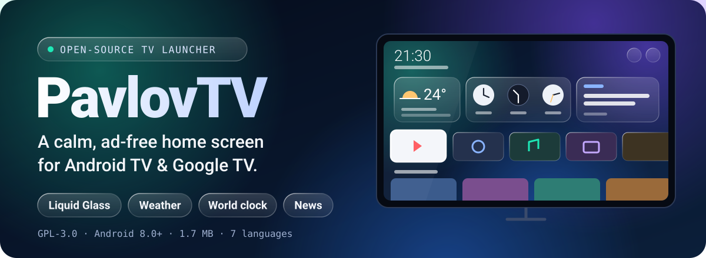
</p>

<p align="center">
  <a href="https://github.com/RemDee13/pavlovtv-launcher/releases/latest"></a>
  <a href="https://github.com/RemDee13/pavlovtv-launcher/releases"></a>
  <a href="./LICENSE"></a>
  
  
</p>

<p align="center">
  <a href="https://github.com/RemDee13/pavlovtv-launcher/releases/latest/download/PavlovTV.apk"></a>
</p>

<p align="center">
  <a href="#-install-in-three-steps"><b>Install</b></a> ·
  <a href="#-features"><b>Features</b></a> ·
  <a href="#-gallery"><b>Gallery</b></a> ·
  <a href="#-private-by-design"><b>Privacy</b></a> ·
  <a href="#-faq"><b>FAQ</b></a> ·
  <a href="#-build-from-source"><b>Build</b></a>
</p>

<br>

<p align="center">
  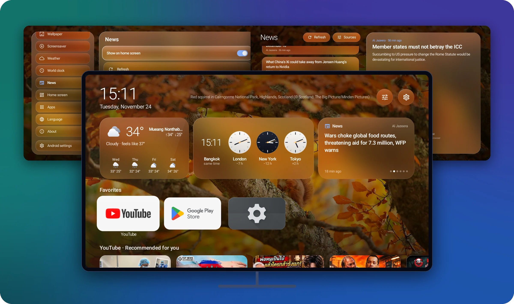
</p>

**PavlovTV** is a free, open-source launcher (home screen) for Android TV and Google TV. It replaces the busy stock home screen with a quiet one: your apps, the weather with the sun and the moon, a world clock, exchange rates and the news, on top of any wallpaper you like. No sponsored rows, no ads, no account, no tracking.

It is built for the remote from the first line of code, it fits in a 1.9 MB APK, and it comes in three looks: see-through **Liquid Glass**, smoky **Dark glass** for the evening, and calm **Solid** panels for those who don't like glass.

<br>

## ✨ Features

<table>
  <tr>
    <td width="33%" valign="top">
      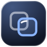<br>
      <b>Liquid Glass, Dark glass or Solid</b><br>
      Frosted panels with light on the edges, smoked glass, or opaque calm cards. One switch changes the whole UI.
    </td>
    <td width="33%" valign="top">
      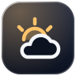<br>
      <b>Weather on a live sky</b><br>
      Feels like, humidity, wind and the chance of rain on a card that turns blue, orange or night-dark with the real sky.
    </td>
    <td width="33%" valign="top">
      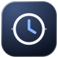<br>
      <b>World clock</b><br>
      Up to 10 cities, analog or digital, with the time difference, the next clock change and “tomorrow” hints.
    </td>
  </tr>
  <tr>
    <td valign="top">
      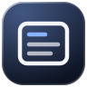<br>
      <b>News</b><br>
      Pick ready topics or search for any subject, or add any site, YouTube channel or RSS feed.
    </td>
    <td valign="top">
      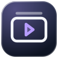<br>
      <b>Recommendations</b><br>
      “Continue watching” and app rows from YouTube, Plex and others. Keep all, some, or just one.
    </td>
    <td valign="top">
      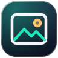<br>
      <b>Any wallpaper</b><br>
      8 built-in gradients, Bing, Unsplash, Wikimedia, public-domain art, NASA, or a link.
    </td>
  </tr>
  <tr>
    <td valign="top">
      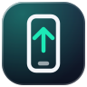<br>
      <b>Photos from your phone</b><br>
      Scan a QR code, pick photos, done. Or load them from TV storage or a USB drive.
    </td>
    <td valign="top">
      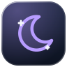<br>
      <b>Screensaver</b><br>
      A slideshow with slow zoom, the clock, the weather and your rates on a soft dark band.
    </td>
    <td valign="top">
      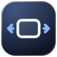<br>
      <b>Move mode</b><br>
      Pick up a tile and slide it along the row with ← →. Hide apps you never open.
    </td>
  </tr>
  <tr>
    <td valign="top">
      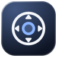<br>
      <b>Made for the remote</b><br>
      Focus always lands where you expect. Back returns you to the exact tile you left.
    </td>
    <td valign="top">
      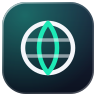<br>
      <b>Seven languages</b><br>
      English, Русский, Español, Türkçe, Deutsch, Français, Português.
    </td>
    <td valign="top">
      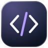<br>
      <b>Open source</b><br>
      GPL-3.0, Kotlin and Jetpack Compose for TV. Read it, fork it, improve it.
    </td>
  </tr>
  <tr>
    <td valign="top">
      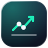<br>
      <b>Rates and stocks</b><br>
      Currencies, crypto, gold and silver, any stock ticker. A 24-hour sparkline on home, full charts from 1 hour to 5 years.
    </td>
    <td valign="top">
      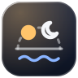<br>
      <b>Sun, moon and sea</b><br>
      The sun on its arc by day, the moon phase by night. Sunrise, golden hour, tides, waves and air quality for each city.
    </td>
    <td valign="top">
      <br>
      <b>Read on the TV</b><br>
      Open a headline and read the article right on the big screen, or scan the QR code to finish it on your phone.
    </td>
  </tr>
</table>

<br>

## 🖼 Gallery

<table>
  <tr>
    <td width="50%">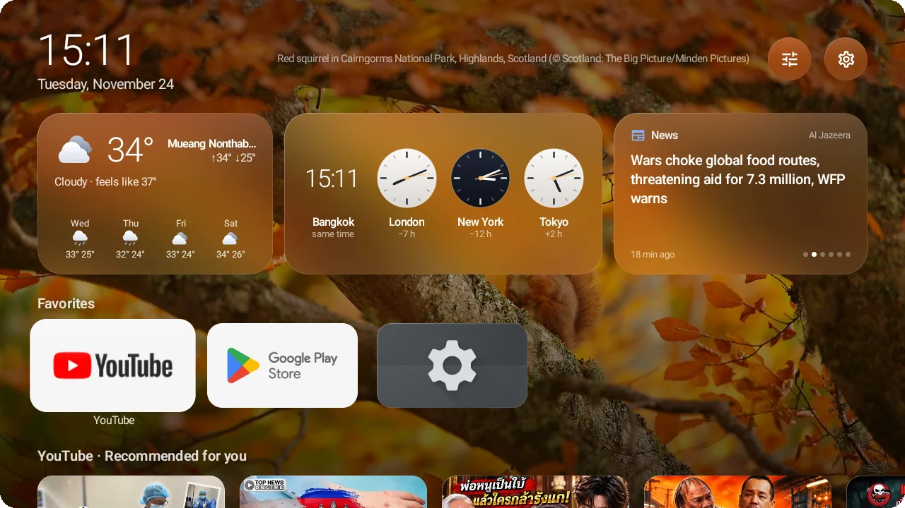</td>
    <td width="50%">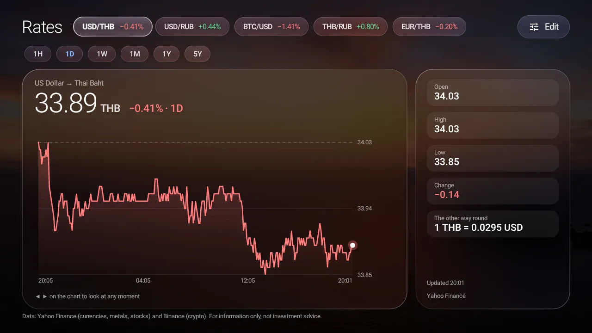</td>
  </tr>
  <tr>
    <td align="center"><sub><b>Home</b> · weather, sky, cities, rates, news</sub></td>
    <td align="center"><sub><b>Rates</b> · 1 hour to 5 years, ← → to read any moment</sub></td>
  </tr>
  <tr>
    <td>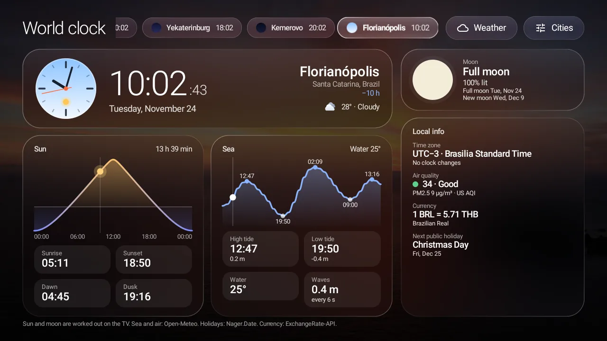</td>
    <td>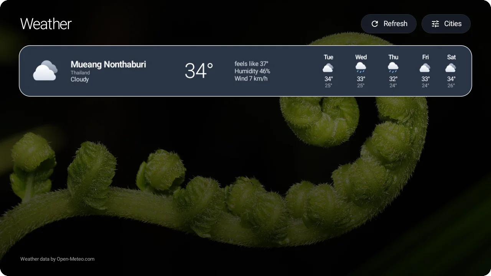</td>
  </tr>
  <tr>
    <td align="center"><sub><b>World clock</b> · sun, sea, moon and local info</sub></td>
    <td align="center"><sub><b>Weather</b> · today and the days ahead</sub></td>
  </tr>
  <tr>
    <td>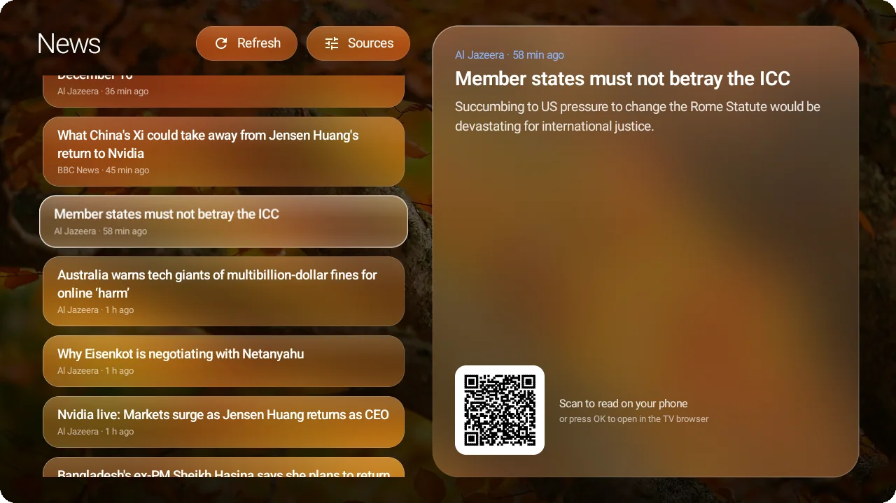</td>
    <td>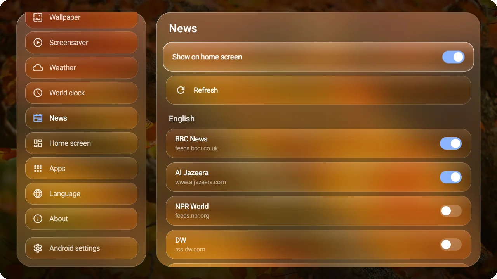</td>
  </tr>
  <tr>
    <td align="center"><sub><b>News</b> · press OK or scan the QR code</sub></td>
    <td align="center"><sub><b>Settings</b> · every page is one press away</sub></td>
  </tr>
  <tr>
    <td>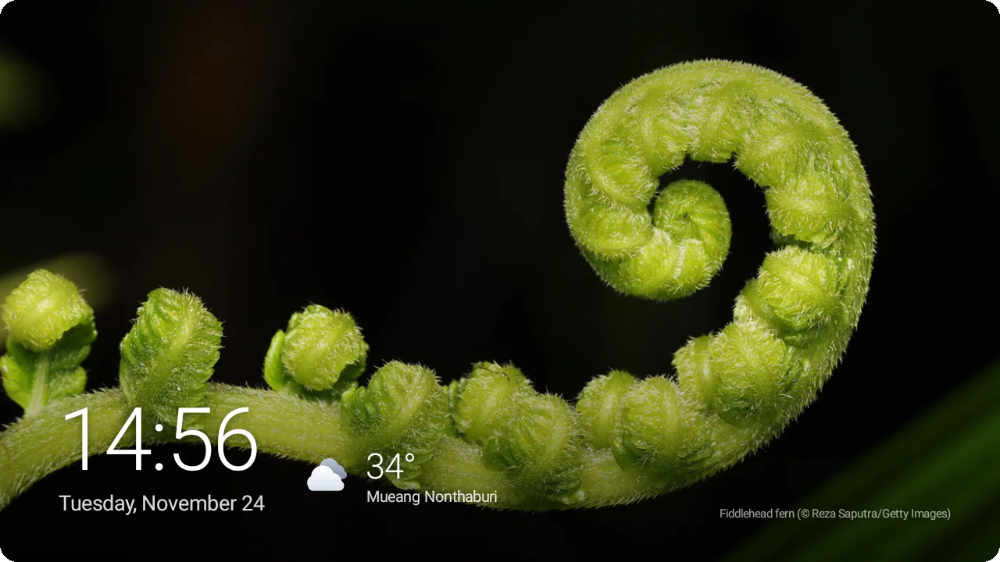</td>
    <td>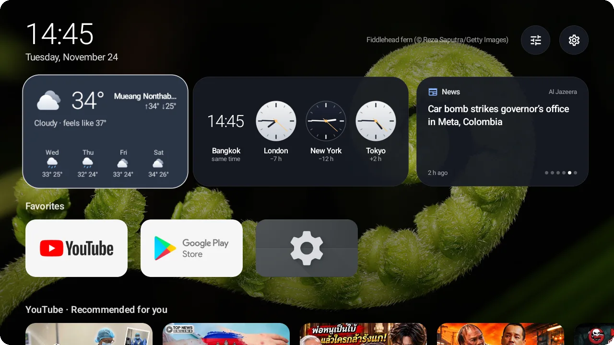</td>
  </tr>
  <tr>
    <td align="center"><sub><b>Screensaver</b> · clock, weather and rates</sub></td>
    <td align="center"><sub><b>Solid style</b> · the same home, no glass</sub></td>
  </tr>
</table>

<br>

## 🚀 Install in three steps

<p align="center">
  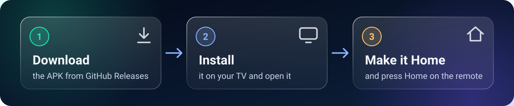
</p>

PavlovTV is not on Google Play, so you install the APK yourself. Pick the way that suits you:

<details open>
<summary><b>Option A: with the Downloader app (no computer needed)</b></summary>

1. On the TV, install **Downloader** by AFTVnews from Google Play.
2. Allow it to install apps: Android settings → Device preferences (or Apps) → Security & restrictions → Unknown sources → Downloader.
3. In Downloader, type this address and press Go:
   ```text
   github.com/RemDee13/pavlovtv-launcher/releases/latest/download/PavlovTV.apk
   ```
4. Press **Install**, then **Open**.

</details>

<details>
<summary><b>Option B: send the APK from your phone</b></summary>

1. Download [`PavlovTV.apk`](https://github.com/RemDee13/pavlovtv-launcher/releases/latest/download/PavlovTV.apk) on your phone.
2. Install **Send Files to TV** on both the phone and the TV.
3. Send the APK, then open it on the TV with any file manager and press **Install**.

</details>

<details>
<summary><b>Option C: with adb from a computer</b></summary>

Turn on Developer options and Network debugging on the TV, then:

```bash
adb connect 192.168.1.50:5555
```

```bash
adb install PavlovTV.apk
```

Use your TV's IP address instead of `192.168.1.50`. You'll find it in Android settings → Network.

</details>

<details>
<summary><b>Keep it updated automatically with Obtainium</b></summary>

[Obtainium](https://github.com/ImranR98/Obtainium) installs updates straight from GitHub Releases. Add this address as a new app:

```text
https://github.com/RemDee13/pavlovtv-launcher
```

</details>

### Make it your home screen

Open PavlovTV, go to **Settings → Home screen → Make PavlovTV the home screen**, choose PavlovTV and press Home on the remote.

If the TV has no Home app picker, run this once from a computer:

```bash
adb shell cmd package set-home-activity io.github.remdee13.pavlovtv/.MainActivity
```

> [!NOTE]
> Some Google TV builds keep the Home button tied to the stock launcher even after you choose another one. PavlovTV still works there: open it from the app row, or map a remote button to it with a button remapper app. Uninstalling PavlovTV always brings the original home screen back.

### Turn on recommendation rows

Recommendation rows need the **TV listings** permission. Press **Allow access** in Settings → Home screen. If nothing happens, grant it once from a computer:

```bash
adb shell pm grant io.github.remdee13.pavlovtv android.permission.READ_TV_LISTINGS
```

### Turn on the screensaver

Android settings → Device preferences → Screensaver → **PavlovTV slideshow**.

<br>

## 🎮 Using it with the remote

| Press | What happens |
|---|---|
| **OK** on a tile | Opens the app |
| **Hold OK** on a tile | Menu: add to favorites, move, hide, app info, uninstall |
| **← →** in Move mode | Slides the tile along the row, as far as you want |
| **OK** or **Back** in Move mode | Drops the tile in its new place |
| **⚙** in the top bar | PavlovTV settings |
| **Back** in any screen | Returns to the exact tile you came from |

<br>

## 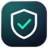 Private by design

No ads, no analytics, no crash reporting, no account, no Google services. Your settings stay on the TV. PavlovTV talks only to the services you turn on, and only to get the data you see on screen:

| What | Service | When |
|---|---|---|
| Weather and city search | [Open-Meteo](https://open-meteo.com) | Weather widget is on |
| Tides, waves and air quality | Open-Meteo Marine and Air Quality | You open the world clock |
| Public holidays | [Nager.Date](https://date.nager.at) | You open the world clock |
| Exchange rate for a city's currency | [ExchangeRate-API](https://www.exchangerate-api.com) | You open the world clock |
| Currencies, metals and stocks | Yahoo Finance | Rates are on |
| Crypto prices | Binance public market data | You added a crypto pair |
| Approximate city by IP | [GeoJS](https://www.geojs.io) | “Detect automatically” is on |
| Wallpapers | Bing, Lorem Picsum, Wikimedia Commons, Art Institute of Chicago, NASA | You chose that source |
| Headlines | Only the feeds and sites you chose, plus Bing News for topics you search | News widget is on |
| Photos and links from your phone | A small web page served by the TV itself, on your Wi-Fi only | While that screen is open |

Sunrise, sunset and the moon phase are worked out on the TV itself. Permissions are the minimum a launcher needs: listing installed apps, reading recommendation rows, reading pictures you choose from storage, and asking Android to uninstall an app when you pick **Uninstall**.

<br>

## 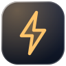 Light on old TVs

| | |
|---|---|
| APK size | **1.9 MB** |
| Memory | about **95 MB** right after start, on a real 1 GB Android TV 11 set |
| Cold start | about **1.3 s** on the same TV |
| Minimum Android | **8.0** (API 26) |
| Slow TV? | Switch to **Solid** style, keep only **Continue watching**, and turn off **Slow motion** in the screensaver |

Many TV boxes ship with 1–2 GB of RAM and a stock launcher that eats a good part of it. PavlovTV keeps nothing running in the background: its only service is the screensaver, which Android starts when the TV goes idle.

<br>

## 🆚 PavlovTV vs. a typical stock home screen

| | PavlovTV | Stock home (varies by TV) |
|---|:---:|:---:|
| Sponsored rows and banners | None | Common on Google TV |
| Your own wallpaper | Any picture | Usually fixed |
| Weather, world clock, rates, news on home | ✅ | — |
| Reorder and hide apps freely | ✅ | Limited |
| Recommendation rows from apps | ✅ you pick which | ✅ |
| Google account required | No | Yes on Google TV |
| Voice search inside the launcher | Not yet | ✅ |
| Open source | ✅ GPL-3.0 | — |

<br>

## 🌄 Free wallpaper sources

| Source | What you get | License |
|---|---|---|
| Gradients | 8 built-in themes: Aurora, Sunset, Ocean, Forest, Graphite, Midnight, Sakura, Desert. Work offline | Part of PavlovTV |
| Bing | Picture of the day, new every morning | © their owners, for wallpaper use only |
| Lorem Picsum | Random photos from Unsplash | Unsplash License |
| Wikimedia Commons | Picture of the day | CC BY-SA and others, credited on screen |
| Art Institute of Chicago | Public-domain paintings | CC0 |
| NASA Image Library | Space and Earth photos | NASA media guidelines |
| My photos | From your phone over Wi-Fi, or from a USB drive | Yours |
| Link | Any picture on the internet | Depends on the picture |

<br>

## 📺 Compatibility

PavlovTV runs on Android TV and Google TV devices with Android 8.0 or newer: smart TVs, TV boxes, Chromecast with Google TV, NVIDIA Shield and similar.

Tested so far on a Toshiba smart TV (Hisense MT5867, Android TV 11, 1 GB of RAM, 32-bit) and on the Android TV 12 emulator.

> [!IMPORTANT]
> If you run PavlovTV on another TV or box, please [open an issue](https://github.com/RemDee13/pavlovtv-launcher/issues) with the model and what worked. It helps a lot.

<br>

## ❓ FAQ

<details>
<summary><b>Is PavlovTV free?</b></summary>

Yes. Free of charge and free software under the GPL-3.0. No paid tier, no ads, ever.

</details>

<details>
<summary><b>Does it work on Google TV, Chromecast with Google TV or NVIDIA Shield?</b></summary>

It installs and runs on any Android TV or Google TV with Android 8.0+. On some Google TV builds the Home button stays with the stock launcher; see the note in [Make it your home screen](#make-it-your-home-screen).

</details>

<details>
<summary><b>Does it work on Amazon Fire TV?</b></summary>

It installs and runs as an app. Fire OS does not let other launchers take over the Home button, so you open PavlovTV from the app list.

</details>

<details>
<summary><b>How do I go back to the original home screen?</b></summary>

Pick the old launcher in the Home app picker, if your TV has one, or simply uninstall PavlovTV. Nothing on the TV is changed for good.

</details>

<details>
<summary><b>Why are there no recommendation rows?</b></summary>

PavlovTV needs the TV listings permission (see [Turn on recommendation rows](#turn-on-recommendation-rows)). Rows also appear only after apps like YouTube have been opened at least once. Some TVs do not share recommendations with other launchers at all; PavlovTV tells you when that is the case.

</details>

<details>
<summary><b>Can I choose which news I see?</b></summary>

Yes. Settings → News → Topics switches on ready-made feeds for AI, technology, business, science or world news in your language. You can also add any website, YouTube channel or RSS link: type it with the remote, or scan the QR code and paste it on your phone. PavlovTV finds the feed itself.

</details>

<details>
<summary><b>Can I use my own photos as wallpaper?</b></summary>

Yes. Open Settings → Wallpaper → Send a photo from your phone, scan the QR code and pick photos. The phone and the TV must be on the same Wi-Fi. You can also load pictures from a USB drive or paste a link.

</details>

<details>
<summary><b>Does it work without the internet?</b></summary>

Apps, favorites and the built-in gradient wallpapers work offline. Weather, news and online wallpapers need a connection.

</details>

<details>
<summary><b>I don't like the glass look.</b></summary>

Settings → Appearance → Interface style → **Dark glass** for smoked, calmer panels, or **Solid** for no glass at all. Solid is a bit lighter for slow TVs too.

</details>

<br>

## 🗺 Roadmap

- [x] Home with favorites, all apps and recommendation rows
- [x] Weather, world clock and news widgets
- [x] Liquid Glass and Solid styles
- [x] Wallpapers and screensaver from 7 free sources and your own photos
- [x] Seven languages
- [x] News by topic and from any site
- [x] Rates and stocks with charts
- [x] Sun, moon, tides and air quality
- [x] Dark glass style
- [ ] Calendar widget
- [ ] Testing on more TVs and boxes
- [ ] Voice search from the home screen
- [ ] More languages, with your help

Have an idea? [Start a discussion or open an issue](https://github.com/RemDee13/pavlovtv-launcher/issues).

<br>

## 🛠 Build from source

You need JDK 17 and the Android SDK.

```bash
git clone https://github.com/RemDee13/pavlovtv-launcher.git
```

```bash
cd pavlovtv-launcher && ./gradlew assembleRelease
```

The APK lands in `app/build/outputs/apk/release/`. Without a signing key it is signed with the debug key, which is fine for your own TV. To sign with your own key, create `keystore.properties` in the project root (it is git-ignored):

```properties
storeFile=/path/to/release.jks
storePassword=...
keyAlias=...
keyPassword=...
```

The same values can come from the `PAVLOVTV_STORE_FILE`, `PAVLOVTV_STORE_PASSWORD`, `PAVLOVTV_KEY_ALIAS` and `PAVLOVTV_KEY_PASSWORD` environment variables, which is what the release workflow uses.

**Stack:** Kotlin 2.1, Jetpack Compose for TV (tv-material 1.0), Coil, OkHttp, kotlinx.serialization, DataStore, ZXing, jsoup.

<br>

## 🤝 Contributing

Bug reports, ideas and pull requests are welcome.

- **Translations.** Every string lives in `app/src/main/res/values-<lang>/strings.xml`. Copy the English file, translate it, and open a pull request.
- **Real-device reports.** Tell us your TV model and Android version, and what worked or didn't.
- **Code.** Keep it light: PavlovTV has to run well on a TV with 1 GB of RAM.

<br>

## 📄 License and credits

PavlovTV is free software under the [GNU General Public License v3.0](./LICENSE).

Weather, sea and air data by [Open-Meteo.com](https://open-meteo.com) (CC BY 4.0). Public holidays by [Nager.Date](https://date.nager.at). Exchange rates by [ExchangeRate-API](https://www.exchangerate-api.com). Market data from Yahoo Finance and Binance, for information only, not investment advice. City search by Open-Meteo Geocoding and GeoNames. Artworks from the [Art Institute of Chicago](https://www.artic.edu) (CC0). Space photos from the [NASA Image and Video Library](https://images.nasa.gov). QR codes by [ZXing](https://github.com/zxing/zxing). Wallpapers shown in the screenshots are Bing, Unsplash and Wikimedia Commons pictures, © their respective owners.

<p align="center">
  <br>
  <sub>If PavlovTV made your TV a little calmer, a ⭐ helps other people find it.</sub>
</p>
